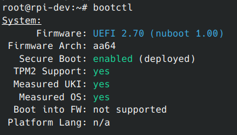

# nuboot



_`bootctl` on a Pi 4 running Debian, started by nuboot: UEFI, Secure Boot and the TPM, with no config file._

nuboot is firmware for headless Raspberry Pi 4 servers, written in Rust. It
replaces Raspberry Pi's `start4.elf` and is started by the stock EEPROM
bootloader. It has a small preemptive thread scheduler and a UEFI firmware of
its own.

- No `config.txt`. The firmware takes its defaults from the board and the boot
  medium.
- No display, camera or audio. A server needs storage, the network and a
  watchdog. The log goes to the serial console, which is optional.
- Every log line has a time, a level, a subsystem and a message, with the values
  as named fields ([docs/logging.md](docs/logging.md)).
- UEFI with Secure Boot starts the OS. It runs only images signed by a key in
  `db`, which holds the builder's key alone: Microsoft's UEFI CAs are not
  trusted unless the owner enrols them
  ([docs/uefi.md](docs/uefi.md#booting-a-distribution)). An owner can replace
  `db` with a certificate of their own in a signed `boot.img`
  ([docs/uefi.md](docs/uefi.md#the-owners-db)).
- A TPM 2.0 runs on the VPU, behind `EFI_TCG2_PROTOCOL` and, for the OS, ACPI
  or the device tree ([docs/tpm2.md](docs/tpm2.md)).
- `start4.elf` carries the UEFI firmware and the device tree, so a board with
  secure boot programmed takes it in a signed `boot.img`
  ([docs/boot.md](docs/boot.md)).
- fwupd updates the firmware and the EEPROM bootloader as ESRT resources
  ([docs/updates.md](docs/updates.md)).
- The ARM runs at 1800 MHz on a Pi 400 and a 4B from rev 1.4, 1500 MHz on the
  others, and slows down while the SoC is hot or the supply is in trouble
  ([docs/boot.md](docs/boot.md#arm-clock-and-core-voltage)).
- After the OS powers the board off, a magic packet for the board's address
  boots it ([docs/boot.md](docs/boot.md#wake-on-lan)).
- The security design, what it defends and what breaks it, is in
  [docs/security.md](docs/security.md).

HATs and IPv6 are out of scope. The OS gets a device tree, and ACPI tables when
it asks for them or has no device tree ([docs/uefi.md](docs/uefi.md#acpi)).

> [!NOTE]
> Early firmware. On a Raspberry Pi 4B rev 1.5 (`d03115`) it boots Debian, Ubuntu
> and Raspberry Pi OS from SD and USB. Other boards
> run only in pimu ([Tested](#tested)).

## What it does

From the boot ROM to the threads that run for as long as the board is up:

1. Raspberry Pi's EEPROM bootloader brings up the SDRAM and starts
   `start4.elf` off the boot medium ([docs/boot.md](docs/boot.md)).
2. `start4.elf` sets up the PL011 on GPIO 14/15 for 115200 8N1, so the log is
   on the serial console with no setting anywhere.
3. It logs the firmware's commit, the board's model and revision code, the boot
   medium, the RAM size and the bootloader's version, and starts the SoC's
   temperature sensor, which the OS reads as a thermal zone.
4. It keeps the boot watchdog fed, hands it to the ARM when the ARM starts, and
   takes it back at `ExitBootServices` until the OS's driver has it. A hang
   anywhere in the boot, or an ARM that stops, resets the board
   ([docs/boot.md](docs/boot.md#boot-watchdog)).
5. It brings up the PCIe link, gives the VL805 USB controller its firmware and
   starts the ARM in the UEFI firmware it carries, with the board's device tree
   ([docs/uefi.md](docs/uefi.md)). UEFI finds the SD card and any USB drive and
   boots `\EFI\BOOT\BOOTAA64.EFI` from them. It measures what it verifies into
   a TPM 2.0 on the VPU and offers `EFI_TCG2_PROTOCOL` over it
   ([docs/tpm2.md](docs/tpm2.md)); the TPM's keys come from the device private
   key ([docs/keystore.md](docs/keystore.md)). The OS finds the TPM through the
   ACPI tables UEFI builds, or through the device tree and a module
   ([docs/os-image.md](docs/os-image.md)). UEFI describes the board in SMBIOS
   tables too.
6. It starts the scheduler: a service thread that answers the property mailbox
   (`NOTIFY_XHCI_RESET`, which reloads the VL805's firmware, and the TPM's
   commands) and a monitor thread that reports each stack's high-water mark.

```text
   0.267088 INFO  boot     nuboot 1a2b3c4  board="Raspberry Pi 4 Model B" revision=d03115 pcb=1.5
   0.267218 INFO  boot     started by the EEPROM bootloader  medium=sd ram_mib=8192 bootloader=1a2b3c4d5e6f708192a3b4c5d6e7f8091a2b3c4d
   0.267905 INFO  thermal  temperature sensor running  celsius=43.8
   0.583645 INFO  usb      VL805 xHCI controller up  bus=1 firmware=loaded registers=0x602000000
   0.595415 INFO  arm      ARM started in UEFI  image_bytes=54910 tree=0xf00000 tree_bytes=56443 memory_mib=8108
   0.595737 INFO  sched    threads running  threads=2 tick_us=1000
```

[docs/logging.md](docs/logging.md) describes the log format.

## Tested

✅ tested (in [pimu](https://github.com/rusty-pi/pimu), or on a board) · ❌ does not work yet · ➖ not tried

The Pi 4B column is a rev 1.5 (`d03115`). Pi 400 and CM4 are untried.

| | pimu | Pi 4B |
|---|---|---|
| Started from SD | ✅ | ✅ |
| Started from a USB drive | ✅ | ✅ |
| Started from the network (TFTP) | ➖ | ✅ |
| Signed `boot.img`: the EEPROM key's image boots | ✅ | ✅ |
| Signed `boot.img`: another key's image is refused | ✅ | ➖ |
| Owner's `db` from `owner-db.der`: its CA's leaves boot, other keys are refused | ✅ | ➖ |
| Other boards: Pi 4B rev 1.4 (`d03114`) and rev 1.2 (`c03112`) | ✅ | ➖ |
| Console log, board identity, threads | ✅ | ✅ |
| Boot watchdog: a hang in UEFI resets the board, `ExitBootServices` hands it to the OS | ✅ | ➖ |
| Linux's `wdat_wdt` takes the watchdog from the ACPI WDAT table and resets the board when it stops pinging | ✅ | ✅ |
| ARM started in UEFI, running a signed EFI application | ✅ | ✅ |
| Secure Boot with Ubuntu's shim signed by a key in `db`; Microsoft's shim and unsigned images refused | ✅ | ➖ |
| USB: VL805 firmware loaded, EFI application off a USB drive, `NOTIFY_XHCI_RESET` | ✅ | ✅ |
| Firmware cryptography service, OTP MAC address, GPIO expander SD pins | ✅ | ✅ |
| TPM 2.0 behind `EFI_TCG2_PROTOCOL`: PCRs, event log, shim and systemd-boot measuring | ✅ | ✅ |
| TPM NV indices and NvPCRs kept across reboots, root sealed to the TPM | ✅ | ✅ |
| Variable store in a GPT window on the boot disk: OS writes flushed at `ResetSystem` and read back | ✅ | ✅ |
| Variable store compaction when the OS has filled a bank | ✅ | ➖ |
| Shutdown through the runtime services ends in the bootloader's halt | ✅ | ✅ |
| Update capsules: verified, and refused when old, changed, wrongly signed or not a capsule | ✅ | ✅ |
| Firmware update as a tryboot: proven at the OS and committed, or dropped | ✅ | ✅ |
| EEPROM update staged, dropped or reported done | ✅ | ➖ |
| Update bundles: signed by the update key, kept across resets, tried three times, then dropped or blessed | ✅ | ✅ |
| ARM at 1800 MHz with the core rail set for the die, slowed while hot or on a PMIC fault (forced) | ✅ | ✅ |
| ARM at 1800 MHz on rev 1.4 and 1500 MHz on rev 1.2 | ✅ | ➖ |
| Wake-on-LAN after power off | ✅ | ✅ |
| Debian 6.12 in a signed unified kernel image, device tree: Secure Boot on, lockdown, `efivarfs`, ESRT, SMBIOS, thermal zone, hardware RNG, `bootctl` | ✅ | ✅ |
| The same with ACPI (`acpi=on`, or an empty device tree): `tpm_crb`, four cores, SD, network, USB, power off | ✅ | ✅ |
| Debian forky 7.2.9 with `acpi=on`: `tpm2_pcrread`, and an event log that replays to every PCR but 9 and 10 | ➖ | ✅ |
| Raspberry Pi OS 6.12.93+rpt in a signed unified kernel image: root on SD, network, USB, `poweroff` and wake by magic packet | ➖ | ✅ |

## Building

With the VC4 toolchain installed ([docs/toolchain.md](docs/toolchain.md)), and
rustup, `xz`, `openssl` and `curl` for the UEFI firmware and device tree it carries
([docs/uefi.md](docs/uefi.md)), `cargo build` builds `start4.elf`, the UEFI
firmware included.

```bash
scripts/build.sh
```

gives `out/start4.elf`. It also needs `python3`, and downloads the stock EEPROM
image the scenarios boot. `scripts/build.sh --features color` colours the log
with ANSI escapes.

A release is an `X.Y.Z` tag on `main`: pushing it builds `start4.elf` in CI and
publishes it as that tag's GitHub release, with the tag's message as the notes
(`.claude/skills/release/SKILL.md` has the steps).

## Running it in pimu

[`scenarios/`](scenarios/) holds the boots CI checks: each names the EEPROM
image, the files of the boot medium and the lines the console has to print.
Build the EFI applications the UEFI scenarios use, signed with a test key, and
a `start4.elf` that trusts that key:

```bash
scripts/build-uefi.sh --test-apps
scripts/build.sh
scripts/build.sh --test-keys
pimu boot --scenario scenarios/uefi-hello.yaml
```

`scripts/run-scenarios.sh` boots several by name, one CPU each, as CI does:

```bash
scripts/run-scenarios.sh uefi-hello persist crypto
```

To boot with a directory as the SD card:

```bash
pimu boot --eeprom out/stock-pieeprom.bin --sd boot/
```

## Licence

MIT, see [`LICENSE`](LICENSE). This is an independent project, not
affiliated with, sanctioned by or endorsed by Raspberry Pi Ltd. or Broadcom.
"Raspberry Pi" is a trademark of Raspberry Pi Ltd., used here only to say
which hardware this runs on.
