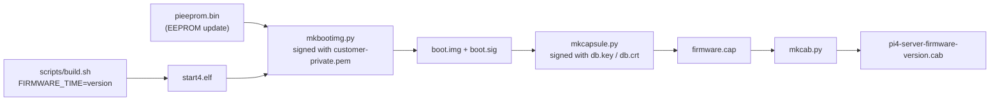
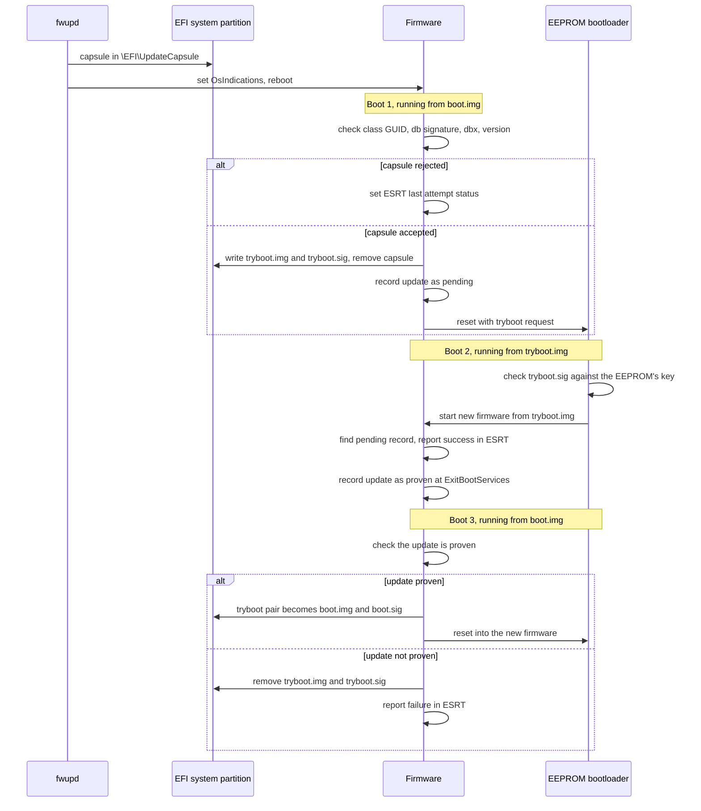
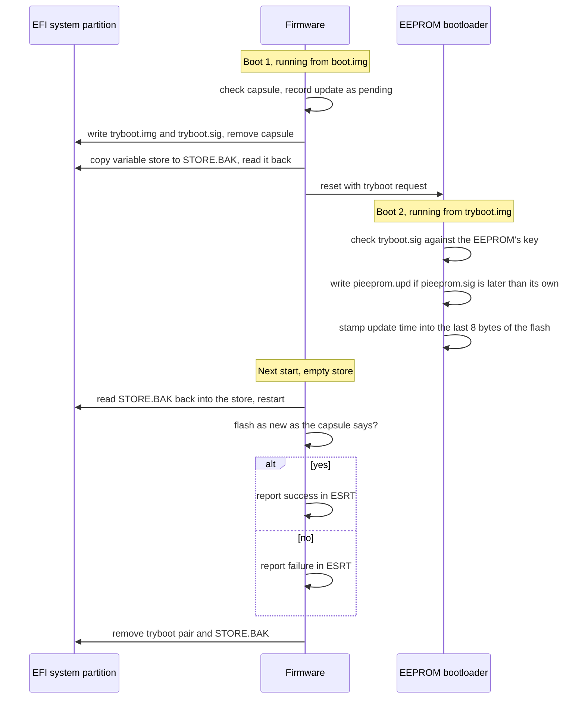

# Updating with fwupd

The firmware offers three resources in the ESRT ([uefi.md](uefi.md#firmware-capsules)),
and fwupd's `uefi-capsule` plugin lists them as devices:

| device | ESRT class GUID | what an update carries | signed by |
|---|---|---|---|
| the firmware | `b4c1e7a2-6d39-4f58-8e10-72a9c5d3f0b6` | a bundle: the whole firmware, VPU and UEFI | an update key |
| the firmware, for a board whose owner signs each image | `7d1c0a4e-5b83-4f2a-9c61-e2084a3d95b7` | `start4.elf`, in a signed `boot.img` | the owner's key |
| the EEPROM bootloader | `3f8a0c5e-91d2-4b7a-a6c3-5d1e08f2b947` | `pieeprom.upd` and `pieeprom.sig`, in a signed `boot.img` | the owner's key |

A capsule's own signature is `db`'s in all three.

```bash
fwupdmgr get-devices
fwupdmgr install pi4-server-firmware-1791753810.cab
```

fwupd puts the capsule in `\EFI\UpdateCapsule` on the EFI system partition and
sets `OsIndications`; the firmware checks it, and applies it over the next
reboots as [uefi.md](uefi.md#firmware-capsules) describes. The root of the
signature is `db`: a capsule's signer has to be a certificate there that is not
Microsoft's.

## Updates the owner does not sign

The owner's key in the OTP signs the `start4.elf` the bootloader loads, once.
That image, the loader, carries the update keys, and a bundle that one of them
signed replaces it at the next boot. Nothing about the bundle needs the owner:
the bootloader never sees it.

1. fwupd puts the capsule in `\EFI\UpdateCapsule`. At boot, UEFI checks the `db`
   signature and the class, and that the version is newer than the running
   firmware's and not older than the newest update that has reached the OS. It
   writes the bundle in the root of the file system the capsule came from, as
   its version in eight hex digits and `.UPD`, removes the capsule, records the
   update as pending, copies the bundle to ARM physical `0x3e000000` and
   resets. The bundle that was running stays where it is.
2. The SDRAM keeps its contents through the reset. The loader checks the
   bundle's ECDSA P-256 signature against its update keys, copies the image to
   the update slot at `0x3ee00200`, leaves its own version and commit where the
   image finds them, and enters it.
3. The image boots as the firmware. It measures the loader's commit and version
   into PCR 0 ahead of its own, starts the ARM, and records the update as
   proven when UEFI reaches `ExitBootServices`.
4. At every later power-up the loader runs first, and its UEFI stages the newest
   `.UPD` again, so the update runs from the second start of each boot. Once
   the update has reached the OS, the older bundles are removed.

A bundle that does not reach `ExitBootServices` is removed, and the next
newest, the one that was running before it, is staged instead; the loader runs
when there is none. A bundle that no update key signed goes the same way. A bundle with a version below the
newest that has reached the OS is refused.

The update replaces what runs after the loader starts the ARM, the VPU's
services included. It does not replace the loader's own code: the part that
reads the file systems and checks the capsule, and the update keys. A change
there is a new `start4.elf`, which the owner signs.

## Making a bundle

The version is the build's commit time, and the bundle carries the same number:

```bash
version=$(date +%s)
FIRMWARE_TIME=$version scripts/build.sh
scripts/mkbundle.py keys/update.key out/start4-update.bin $version out/bundle.bin
scripts/mkcapsule.py keys/db.key keys/db.crt $version out/update.cap --class update --bundle out/bundle.bin
scripts/mkcab.py out/update.cap out/pi4-server-firmware-update-$version.cab $version --class update
```

`keys/update.key` is the key whose public half, `keys/update.pub`, the loader
was built with (`scripts/genkeys.sh` makes both, and `PI4_UPDATE_PUB` names
another public key for a build). `out/start4-update.bin` is the same firmware
linked for the update slot.

## Making an update for a board whose owner signs each image

The firmware needs the version it will report, which is a number that grows
from one release to the next, and a Unix time is one:

```bash
version=$(date +%s)
FIRMWARE_TIME=$version scripts/build.sh
scripts/mkbootimg.py customer-private.pem out/start4.elf out
scripts/mkcapsule.py keys/db.key keys/db.crt $version out/firmware.cap \
    --boot-img out/boot.img --boot-sig out/boot.sig
scripts/mkcab.py out/firmware.cap out/pi4-server-firmware-$version.cab $version
```

`customer-private.pem` is the key whose public half the EEPROM holds
([boot.md](boot.md#signed-boot)). An update of the EEPROM bootloader is made
the same way with `--class eeprom` for `mkcapsule.py` and `mkcab.py`, a
`boot.img` that carries the new image (`mkbootimg.py --eeprom pieeprom.bin:TIME`,
with the configuration and the public key already in `pieeprom.bin`) and `TIME`
as the version.

`scripts/mkcab.py` needs `gcab`. `fwupdtool get-details` shows what fwupd
makes of the cabinet, the device GUID and the version among them.



## Applying an update

The firmware applies a capsule on the boot after fwupd stages it. A firmware
update takes three boots; the new firmware runs once from `tryboot.img` before
it replaces `boot.img`:



A boot from `tryboot.img` that fails before `ExitBootServices` is followed by
one from `boot.img`, which is boot 3 with the update not proven.

An update of the EEPROM bootloader stages the same way, with the variable
store saved around the EEPROM write, which erases it:



## Keys

fwupd also updates `KEK`, `db` and `dbx` from the OS, with its `uefi-kek`,
`uefi-db` and `uefi-dbx` plugins, which write the variables through the runtime
services. The firmware accepts the writes that a `PK` or `KEK` key signed and
keeps them ([uefi.md](uefi.md#updating-the-keys)). `PK` is built in.
