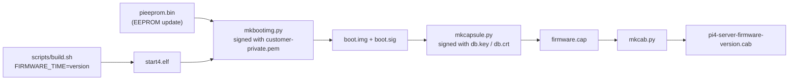
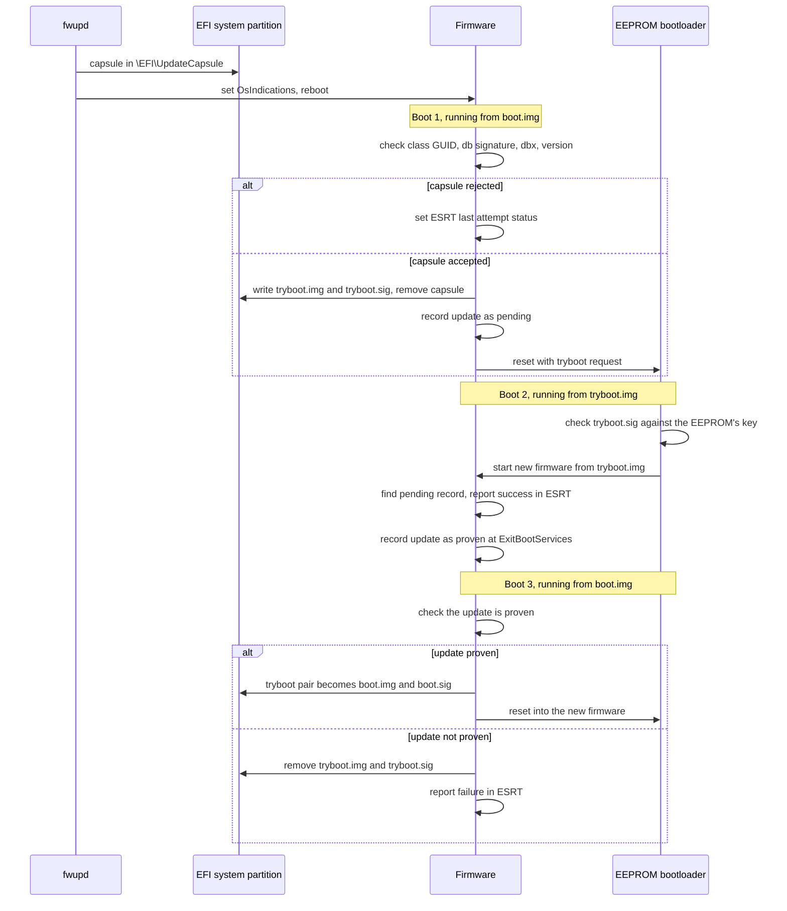
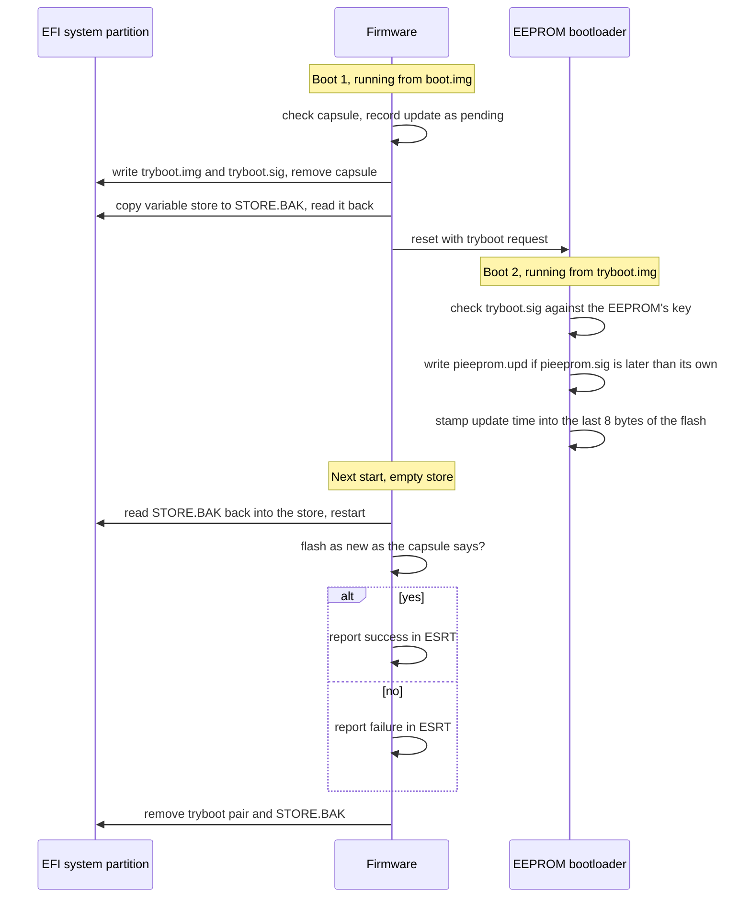

# Updating with fwupd

The firmware offers two resources in the ESRT ([uefi.md](uefi.md#firmware-capsules)),
and fwupd's `uefi-capsule` plugin lists them as devices:

| device | ESRT class GUID | what an update carries |
|---|---|---|
| the firmware | `7d1c0a4e-5b83-4f2a-9c61-e2084a3d95b7` | `start4.elf`, in a signed `boot.img` |
| the EEPROM bootloader | `3f8a0c5e-91d2-4b7a-a6c3-5d1e08f2b947` | `pieeprom.upd` and `pieeprom.sig`, in a signed `boot.img` |

```bash
fwupdmgr get-devices
fwupdmgr install pi4-server-firmware-1791753810.cab
```

fwupd puts the capsule in `\EFI\UpdateCapsule` on the EFI system partition and
sets `OsIndications`; the firmware checks it, and applies it over the next
reboots as [uefi.md](uefi.md#firmware-capsules) describes. The root of the
signature is `db`: a capsule's signer has to be a certificate there that is not
Microsoft's.

## Making an update

The firmware needs the version it will report, which is a number that grows
from one release to the next, and a Unix time is one:

```bash
version=$(date +%s)
FIRMWARE_TIME=$version scripts/build.sh
scripts/mkbootimg.py customer-private.pem out/start4.elf out
scripts/mkcapsule.py keys/db.key keys/db.crt $version out/firmware.cap \
    --boot-img out/boot.img --boot-sig out/boot.sig
scripts/mkcab.py out/firmware.cap out/pi4-server-firmware-$version.cab $version
```

`customer-private.pem` is the key whose public half the EEPROM holds
([boot.md](boot.md#signed-boot)). An update of the EEPROM bootloader is made
the same way with `--class eeprom` for `mkcapsule.py` and `mkcab.py`, a
`boot.img` that carries the new image (`mkbootimg.py --eeprom pieeprom.bin:TIME`,
with the configuration and the public key already in `pieeprom.bin`) and `TIME`
as the version.

`scripts/mkcab.py` needs `gcab`. `fwupdtool get-details` shows what fwupd
makes of the cabinet, the device GUID and the version among them.



## Applying an update

The firmware applies a capsule on the boot after fwupd stages it. A firmware
update takes three boots; the new firmware runs once from `tryboot.img` before
it replaces `boot.img`:



A boot from `tryboot.img` that fails before `ExitBootServices` is followed by
one from `boot.img`, which is boot 3 with the update not proven.

An update of the EEPROM bootloader stages the same way, with the variable
store saved around the EEPROM write, which erases it:



## Keys

fwupd also updates `KEK`, `db` and `dbx` from the OS, with its `uefi-kek`,
`uefi-db` and `uefi-dbx` plugins, which write the variables through the runtime
services. The firmware accepts the writes that a `PK` or `KEK` key signed and
keeps them ([uefi.md](uefi.md#updating-the-keys)). `PK` is built in.
