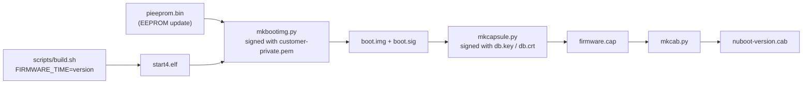
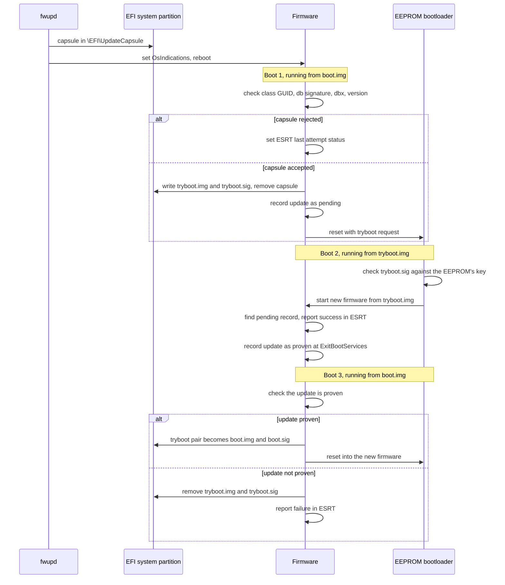
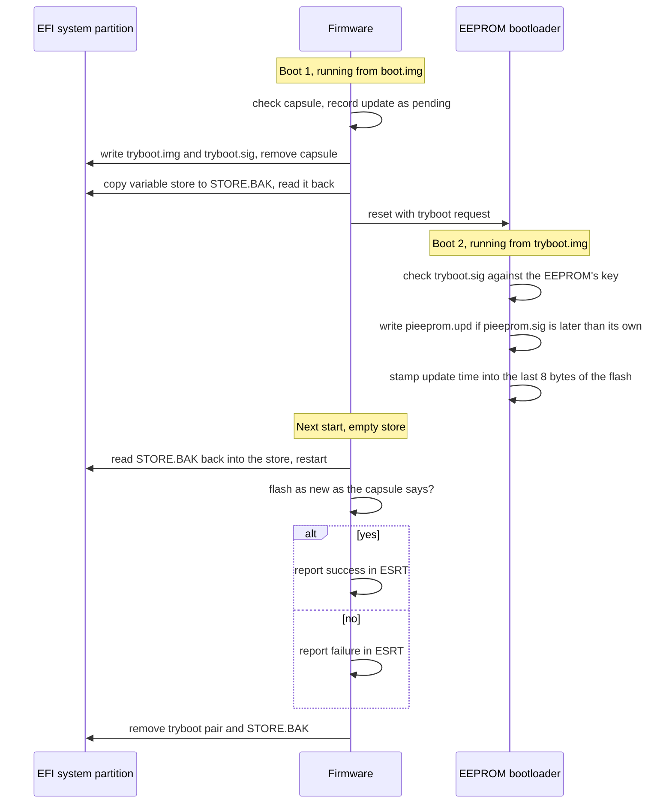

# Updating with fwupd

The firmware offers three resources in the ESRT ([uefi.md](uefi.md#firmware-capsules)),
and fwupd's `uefi-capsule` plugin lists them as devices:

| device | ESRT class GUID | what an update carries | signed by |
|---|---|---|---|
| the firmware | `b4c1e7a2-6d39-4f58-8e10-72a9c5d3f0b6` | a bundle: the whole firmware, VPU and UEFI | an update key |
| the firmware, for a board whose owner signs each image | `7d1c0a4e-5b83-4f2a-9c61-e2084a3d95b7` | `start4.elf`, in a signed `boot.img` | the owner's key |
| the EEPROM bootloader | `3f8a0c5e-91d2-4b7a-a6c3-5d1e08f2b947` | `pieeprom.upd` and `pieeprom.sig`, in a signed `boot.img` | the owner's key |

A capsule's own signature is `db`'s in all three.

```bash
fwupdmgr get-devices
fwupdmgr install nuboot-1791753810.cab
```

fwupd puts the capsule in `\EFI\UpdateCapsule` on the EFI system partition and
sets `OsIndications`; the firmware checks it, and applies it over the next
reboots as [uefi.md](uefi.md#firmware-capsules) describes. The root of the
signature is `db`: a capsule's signer has to be a certificate there that is not
Microsoft's.

## Updates the owner does not sign

The owner's key in the OTP signs the `start4.elf` the bootloader loads, once.
That image, the loader, carries the update keys, and a bundle that one of them
signed replaces it at the next boot. Nothing about the bundle needs the owner:
the bootloader never sees it.

1. fwupd puts the capsule in `\EFI\UpdateCapsule`. At boot, UEFI checks the `db`
   signature and the class, and that the version is newer than the running
   firmware's and not older than the newest update that has reached the OS. It
   writes the bundle in the root of the file system UEFI boots from, as
   `nuboot-0.2.0+2-1.upd` (or its version in eight hex digits, for
   a build with no release), removes the capsule, copies the bundle to ARM
   physical `0x3e000000` and resets. The bundle that was running stays where it
   is. The `+2-1` is the bundle's tries left and tries done.
2. The SDRAM keeps its contents through the reset. The loader checks the
   bundle's ECDSA P-256 signature against its update keys, copies the image to
   the update slot at `0x3ee00200`, leaves its own version and commit where the
   image finds them, and enters it.
3. The image boots as the firmware. It measures the loader's commit and version,
   and the SHA-256 the loader took of the image, into PCR 0 ahead of its own
   events, and starts the ARM. When UEFI reaches
   `ExitBootServices` it blesses the bundle, by dropping the counter from its
   name, and removes the older bundles.
4. At every later power-up the loader runs first, and its UEFI stages the newest
   `.upd` again, so the update runs from the second start of each boot. The
file system UEFI boots from is the first, the SD card then a USB drive, that has
`\EFI\BOOT\BOOTAA64.EFI`; no other volume is read for bundles.

The counter works as boot assessment does in systemd
(<https://systemd.io/AUTOMATIC_BOOT_ASSESSMENT/>). A new bundle has three
tries. Every attempt to run a bundle that is not blessed renames it to take one
(`+3`, `+2-1`, `+1-2`, `+0-3`) before it starts, so a failure that comes and
goes, a power cut or a card that was slow to answer, costs a try and not the
update. A bundle that reaches `ExitBootServices` is blessed whatever the try. A
bundle at `+0` is removed, and the next newest, the one that was running before
it, is staged instead; the loader runs when there is none. A bundle that no
update key signed goes the same way, after its tries. A bundle with a version
below the newest that has reached the OS is refused.

The update replaces what runs after the loader starts the ARM, the VPU's
services included. It does not replace the loader's own code: the part that
reads the file systems and checks the capsule, and the update keys. A change
there is a new `start4.elf`, which the owner signs.

## Versions

A release is `X.Y.Z`, the release tag, and its version is the number
`X<<24 | Y<<16 | Z`, so that the order of two releases is the order of their
numbers (`0.10.0` is above `0.9.0`) and fwupd shows the number as `X.Y.Z` in its
`triplet` format. A release is at most `255.255.65535`. A build that is no
release has the number `FIRMWARE_TIME` gives it, or the commit's time, which no
release is above: a board that runs such a build takes no release as an update.

The loader takes a bundle only when its version is above its own, and the file
says the version: the release in its name, or the eight hex digits.

## Making a bundle

The version is what the build is given, and the bundle carries the same:

```bash
release=0.2.0
FIRMWARE_VERSION=$release scripts/build.sh
scripts/mkbundle.py keys/update.key out/start4-update.bin $release out/bundle.bin
scripts/mkcapsule.py keys/db.key keys/db.crt $release out/update.cap --class update --bundle out/bundle.bin
scripts/mkcab.py out/update.cap out/nuboot-update-$release.cab $release --class update
```

`keys/update.key` is the key whose public half, `keys/update.pub`, the loader
was built with (`scripts/genkeys.sh` makes both, and `PI4_UPDATE_PUB` names
another public key for a build). `out/start4-update.bin` is the same firmware
linked for the update slot.

## Making an update for a board whose owner signs each image

The firmware needs the version it will report, which is a number that grows
from one release to the next, and a Unix time is one:

```bash
version=$(date +%s)
FIRMWARE_TIME=$version scripts/build.sh
scripts/mkbootimg.py customer-private.pem out/start4.elf out
scripts/mkcapsule.py keys/db.key keys/db.crt $version out/firmware.cap \
    --boot-img out/boot.img --boot-sig out/boot.sig
scripts/mkcab.py out/firmware.cap out/nuboot-$version.cab $version
```

`customer-private.pem` is the key whose public half the EEPROM holds
([boot.md](boot.md#signed-boot)). An update of the EEPROM bootloader is made
the same way with `--class eeprom` for `mkcapsule.py` and `mkcab.py`, a
`boot.img` that carries the new image (`mkbootimg.py --eeprom pieeprom.bin:TIME`,
with the configuration and the public key already in `pieeprom.bin`) and `TIME`
as the version.

`scripts/mkcab.py` needs `gcab`. `fwupdtool get-details` shows what fwupd
makes of the cabinet, the device GUID and the version among them.



## Applying an update

The firmware applies a capsule on the boot after fwupd stages it. A firmware
update takes three boots; the new firmware runs once from `tryboot.img` before
it replaces `boot.img`:



A boot from `tryboot.img` that fails before `ExitBootServices` is followed by
one from `boot.img`, which is boot 3 with the update not proven.

An update of the EEPROM bootloader stages the same way, with the variable
store saved around the EEPROM write, which erases it:



## Keys

fwupd also updates `KEK`, `db` and `dbx` from the OS, with its `uefi-kek`,
`uefi-db` and `uefi-dbx` plugins, which write the variables through the runtime
services. The firmware accepts the writes that a `PK` or `KEK` key signed and
keeps them ([uefi.md](uefi.md#updating-the-keys)). `PK` is built in.
